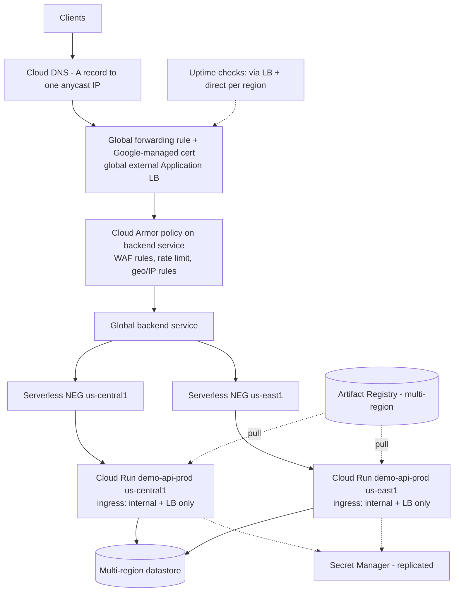

# HA and load-balancing design: two-region Cloud Run

> **Status: design only. Nothing in section "Design" is deployed or implemented in this repository.**
> The "Repository readiness" table at the end separates what exists today from what is conceptual.
> Cloud Run service health and its load-balancer integration are newer GCP features: confirm their launch stage,
> quotas and limits in current Google documentation before committing to the RTO below.

## Design

**Front door.** One global external Application Load Balancer with a single anycast IP, a Google-managed certificate
(Certificate Manager), and a global backend service holding **one serverless NEG per region**, each pointing at that region's
Cloud Run service. Cloud Armor is attached to the backend service (preconfigured WAF rules, per-client rate limiting, and IP/geo rules as policy requires;
adaptive protection for L7 DDoS signals). Cloud Run ingress is `internal-and-cloud-load-balancing`, so the `run.app` URL cannot be used to bypass Armor.

**Traffic routing.** The LB sends each request to the closest healthy region (active-active) and spreads across regions by
capacity when a region saturates. Both regions run the same digest, deployed by the same pipeline.

**Regional failure detection.** Use Cloud Run **service health**: instance-level **readiness probes** (our `/ready`, which already
returns 503 while draining) are aggregated into a per-region health signal exposed through each serverless NEG. The LB reads that
signal, so a region whose service is unhealthy is taken out of rotation without DNS changes. Per Google's description, the LB treats instances with unknown state as healthy,
which is also what makes a single-region canary possible (below). Ordinary serverless NEGs have no LB health checks of their own, so *without* service health a
region could fail while still receiving traffic; the manual fallback is to remove or drain the region's backend (capacity scaler 0) from the runbook.
Caveat to verify: Google documents that IAP cannot be enabled on a backend using this feature, so client authentication stays at Cloud Run IAM/ID tokens or the app.

**Failover.** On unhealthy region: LB shifts its share to the healthy region. Pre-conditions that make this actually work: the surviving region
must absorb 100% of peak (quota + `max_instances` + warm `min_instances` sized for N-1), and downstream dependencies must tolerate the shifted load.

**Recovery and failback.** When readiness recovers, the LB restores traffic gradually. Failback is therefore automatic and gradual; operators verify with
per-region metrics before declaring the incident over, and keep deploys frozen until both regions are stable. A forced/manual failback is done by
re-enabling the backend after validating the region.

**Releases.** Deploy to one **canary region** first, verify its health/SLOs, then the second region (sequential applies, per-region state and approval).
Rollback = redeploy previous digest per region via the existing rollback workflow; emergency = traffic shift per region.

## Stateful and external dependencies that can defeat "HA"

| Dependency | Risk | Mitigation |
|---|---|---|
| Database / datastore | single-region DB makes two Cloud Run regions meaningless | multi-region store (Spanner multi-region, Firestore multi-region) or Cloud SQL HA + cross-region replica with a promotion runbook (non-zero RPO/RTO) |
| Secret Manager | secret replication policy | user-managed replication to both regions (or automatic), pinned versions, rotation tested in both |
| Artifact Registry | regional repo unavailable during a regional event blocks new instances | multi-region repository location or per-region repos with mirrored digests |
| Terraform state bucket / GitHub / WIF | control-plane dependency for *changes*, not serving | dual/multi-region state bucket; break-glass procedure; serving does not depend on CI |
| Cloud DNS / certificates / Cloud Armor / LB | global control planes (shared fate with GCP) | accepted risk; monitor; multi-provider is out of scope |
| Third-party APIs | their region/uptime | timeouts, circuit breakers, degrade gracefully |
| Per-region quotas | surviving region can't scale fast enough | pre-raise quotas; N-1 sizing; load test failover |
| Connection storms | failover floods the DB with new connections | pooled connections / proxy, `max_instances` as a dependency-protection ceiling |
| Session or in-memory state | breaks on failover | service is stateless by design; keep it that way |

## RTO / RPO (assumptions, not measurements)

- **RPO:** the stateless tier holds no data, so its RPO is **0 by design**. Effective RPO equals the datastore's: ~0 with a synchronous multi-region store; seconds-minutes with async cross-region replication.
- **RTO (service tier, automated):** assumed **about 2-5 minutes**: probe/aggregation delay (tens of seconds) + LB reaction (seconds) + scale-up of the surviving region (cold starts, tens of seconds) + client retry/connection churn. **RTO (stateful dependency failover, manual):** assumed **15-60 minutes** unless the store is natively multi-region.
- **Evidence to validate:** (1) game day: force region A's `/ready` to fail (or block its NEG) and measure time to first healthy response from probes and the error rate during the shift; (2) load test at peak with one region out to verify N-1 capacity and dependency load; (3) fail back and watch for flapping; (4) a restore/promotion drill for the datastore with measured RPO; (5) verify alerts fire and humans can execute the runbook within the assumed time. Record results here; until then these numbers are hypotheses.

## Identity, secrets, observability, rollback, cost

- **Identity:** same module per region -> a runtime SA per region today (see limitation below); least-privilege secret access; WIF-only CI; Armor + ingress restriction at the edge; the LB's identity or client ID tokens added to `invoker_members` by reviewed PR.
- **Secrets:** Secret Manager references only; replicated; pinned versions in prod; rotation procedure tested against both regions.
- **Observability:** SLOs on the global endpoint (availability, p95 latency); uptime checks through the LB *and* directly per region (so a region can be diagnosed while hidden by failover); LB logs; per-region dashboards by revision; alerts on regional health-state changes and on N-1 headroom; trace propagation.
- **Rollback:** per-region, digest-based, canary-first; freeze flag stops promotions.
- **Cost:** roughly 2x baseline compute (each region needs warm capacity sized for N-1, so `min_instances > 0` in both), plus LB forwarding rule and data processing, Cloud Armor policy/request charges, inter-region egress, multi-region datastore and registry storage premiums. Dev stays single-region, scale-to-zero.

## Repository readiness

| Item | State |
|---|---|
| Single-region Cloud Run module, digest-pinned deploys, readiness endpoint `/ready` that drains on SIGTERM | **Implemented** (tests/validation per README) |
| Ingress restricted to internal+LB by default; IAM-only access | **Implemented** |
| Per-environment config without code copy; remote state design | **Implemented** (config) / buckets **not created** |
| Two-region instantiation | **Conceptual.** Calling the module twice in one project would collide on the runtime service-account id; needs a `runtime_service_account_email` input or a region suffix, per-region state prefixes and a region-matrix deploy workflow |
| Cloud Run readiness probe wired for service health | **Conceptual** (module currently configures startup + liveness probes only) |
| Load balancer, serverless NEGs, Cloud Armor, certificate, DNS | **Conceptual** (no Terraform written, none deployed) |
| Multi-region datastore, replication, quotas | **Conceptual** (the demo service has no datastore) |
| RTO/RPO numbers | **Assumptions**, unvalidated |
